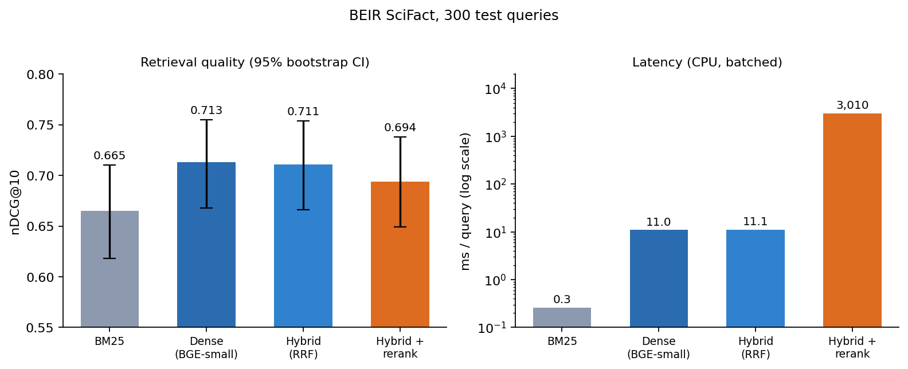
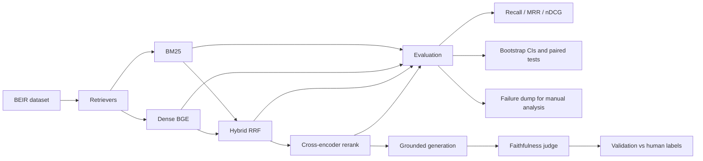

# rag-evaluation-study

**A controlled, statistically tested comparison of RAG retrieval strategies: BM25, dense, hybrid (RRF) and cross-encoder reranking, on BEIR SciFact.**

  

Most RAG demos show that a pipeline *works*. This project measures *which retrieval strategy works better, by how much, and at what cost*, with confidence intervals, paired significance tests and a manual error analysis, instead of a single headline number.

## Who this is for

- **Engineers building RAG systems** who need evidence for choices like "do we need a reranker?" or "is hybrid search worth the complexity?"
- **Hiring managers and reviewers** looking for an example of hypothesis-driven evaluation: clear question, fixed baselines, honest reporting of negative results.
- **Anyone learning retrieval evaluation**: the metrics, bootstrap tests and pipeline are small, readable and unit-tested.

## Key results



| System | nDCG@10 [95% CI] | Recall@10 | MRR@10 | ms/query | Δ nDCG vs BM25 (paired bootstrap) |
|---|---|---|---|---|---|
| BM25 | 0.665 [0.618, 0.710] | 0.785 | 0.633 | 0.3 | baseline |
| Dense (BGE-small) | 0.713 [0.668, 0.755] | 0.836 | 0.682 | 11 | +0.048 [+0.012, +0.084], p = 0.010 |
| Hybrid (RRF) | 0.711 [0.666, 0.754] | 0.828 | 0.680 | 11 | +0.046 [+0.023, +0.070], p < 0.001 |
| Hybrid + rerank (top-50) | 0.694 [0.649, 0.738] | 0.822 | 0.663 | 3,010 | +0.030 [-0.003, +0.062], p = 0.072 |

300 SciFact test queries, CPU only. p-values are uncorrected for multiple comparisons.

### What the data says

1. **Dense retrieval beats BM25.** The confidence interval of the gain excludes zero.
2. **Hybrid search did not improve on dense alone** (0.711 vs 0.713, a difference within noise). Equal-weight RRF added complexity without a measurable benefit on this dataset.
3. **Cross-encoder reranking gave no significant gain** and cost roughly 270x more latency per query. A plausible but untested explanation: the reranker was trained on MS MARCO web questions, while SciFact queries are scientific claims.

Negative results are reported as found. The aim is evidence, not a leaderboard.

## Error analysis

46 of 300 queries had no relevant document in the dense retriever's top 10. They were categorised by hand (`analysis/errors_vector_labeled.csv`):

| Category | Count | Share | Description |
|---|---|---|---|
| Paired claims | 13 | 28% | Several claims share one gold paper, often with opposite polarity ("increases" vs "reduces"). Topic-based retrieval cannot tell them apart. |
| Right topic, wrong paper | 24 | 52% | On-topic results, but not the labelled paper. Some may be relevant but unlabelled. |
| Gold title not visible | 9 | 20% | No overlap between the claim and the gold paper's title. |

These categories were drafted from titles. [Update: N cases were checked against gold abstracts; M were reclassified as label noise.]

The polarity problem also suggests why reranking did not help: a relevance model sees the same topic in both claims.

## What is built

- **Four retrieval systems** behind one interface: BM25 (own implementation, Lucene-style IDF), dense (sentence-transformers + exact cosine search with cached embeddings), hybrid via Reciprocal Rank Fusion with optional weights, and a cross-encoder reranker.
- **Metrics from scratch**: Recall@k, MRR@k and graded nDCG@k, unit-tested against hand-computed values.
- **Statistics**: bootstrap confidence intervals over queries and paired bootstrap tests between systems.
- **Config-driven experiments**: every run is a YAML file; results store the config hash, git commit, timings and per-query metrics for full reproducibility.
- **Failure analysis tooling**: dumps missed queries with gold and retrieved titles for manual categorisation.
- **Grounded generation and faithfulness (implemented, evaluation in progress)**: LLM answers from retrieved passages with citations and an abstain option, deterministic citation-validity checks, an LLM judge for faithfulness, and a validation step comparing the judge with human labels (accuracy and Cohen's kappa). Cached multi-provider client (Groq, Gemini).
- **FastAPI service** to submit experiments and read results.
- **CI**: unit tests run on every push.

## Architecture



## Quickstart

```bash
git clone https://github.com/KiruthikaSelvaraj1/rag-evaluation-study.git
cd rag-evaluation-study
python -m venv .venv
source .venv/bin/activate          # Windows: .venv\Scripts\activate
pip install -e ".[dev,models]"
pytest -q                          # 21 tests, no downloads needed
```

Run the study (downloads SciFact and two small models; the first dense run embeds ~5k documents on CPU):

```bash
python -m rag_study run configs/bm25.yaml
python -m rag_study run configs/vector.yaml
python -m rag_study run configs/hybrid.yaml
python -m rag_study run configs/hybrid_rerank.yaml
python -m rag_study compare --baseline bm25 --names bm25,vector,hybrid,hybrid_rerank
```

Offline smoke test on synthetic data: `python -m rag_study run configs/smoke_bm25.yaml`.

| Task | Command |
|---|---|
| Dump retrieval failures to categorise | `python -m rag_study errors vector --n 50` |
| Generate grounded answers (needs an API key) | `python -m rag_study generate vector --n 100` |
| Build a human-labelling sheet | `python -m rag_study label-sheet --systems bm25,vector --n 100` |
| Validate the judge against human labels | `python -m rag_study validate --system bm25` |
| Judge faithfulness | `python -m rag_study judge vector` |
| Start the API | `uvicorn rag_study.api:app` |

API keys are read from `GROQ_API_KEY` or `GEMINI_API_KEY`; set the model in `configs/llm.yaml`.

## Method

- **Dataset:** BEIR SciFact, test split (300 queries, ~5k documents).
- **Systems:** BM25 (regex tokenizer, no stemming); BAAI/bge-small-en-v1.5; RRF with k = 60 and equal weights; cross-encoder/ms-marco-MiniLM-L-6-v2 reranking the top 50 hybrid candidates.
- **Uncertainty:** retrieval is deterministic, so variance comes from the query sample. Confidence intervals are bootstrapped over queries (10,000 resamples) and system comparisons are paired.
- **Latency:** batched wall-clock time on a CPU laptop. Compare systems relatively, not absolutely.

## Limitations

- One dataset, small models, 300 queries. Results may not transfer to other domains.
- SciFact labels are sparse, so some "misses" may be relevant but unlabelled documents.
- BM25 has no stemming or stopword handling, so it sits slightly below tuned implementations.
- p-values are uncorrected for multiple comparisons, and hybrid vs dense is not tested separately here.
- This is an engineering and experimental study, not a novel research contribution.

## Roadmap

- [ ] Faithfulness results with judge-vs-human agreement
- [ ] Weighted-fusion ablation (dense weighted above BM25)
- [ ] Replicate on a second BEIR dataset (e.g. NFCorpus)
- [ ] Fine-tuned or domain-matched reranker

## Repository structure

```
src/rag_study/   retrieval, metrics, stats, runner, compare, generation, judge, errors, api
configs/         one YAML per experiment
tests/           unit tests (metrics, retrieval, stats, generation, API)
analysis/        error-analysis files
results/         per-run metrics and rankings
docs/            figures

```
## Generation and faithfulness

LLM answers (openai/gpt-oss-20b via Groq) were generated from the top-5 retrieved passages with citations and an abstain option, for the same 100 sampled queries per system.

| Deterministic metric (n = 100) | BM25 | Dense |
|---|---|---|
| Abstained (insufficient evidence) | 53% | 56% |
| Citations pointing to a retrieved passage | 100% | 100% |
| Cites a gold-labelled passage | 33% | 35% |
| Gold passage in top-5 context | 75% | 67% |

The differences between systems are within sampling noise at n = 100.

**LLM-as-judge faithfulness was not reliable, so no faithfulness ranking is reported.** I hand-labelled answers and compared them with a judge (same model family):

| Check | n | Result |
|---|---|---|
| Judge vs human labels, strict first pass | 60 | accuracy 0.37, kappa -0.04 |
| My first pass vs my second pass (written rule) | 46 | agreement 0.33, kappa -0.26 |
| Judge vs human labels, second pass | 46 | accuracy 0.76, kappa 0.22 |

The judge approved 83% of answers regardless of the human label. The same 46 answers were rated faithful 43% of the time under a strict reading and 76% under a lenient one, so the labelling rule itself was ambiguous. Next steps would be a tighter written rubric, a second independent annotator, and a stronger judge from a different model family.

## Author

Built by [Kiruthika](https://github.com/KiruthikaSelvaraj1). Feedback and issues are welcome.

Released under the [MIT License](LICENSE).
